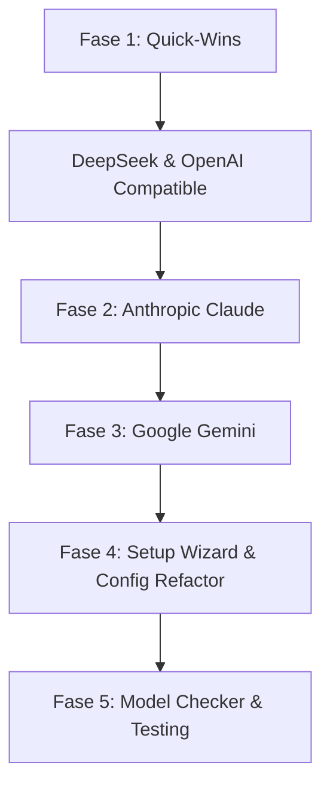

# 🌐 Rencana Arsitektur Multi-Provider (Multi-Provider Architecture Plan)

> **Dokumen Perencanaan Teknis:** Ekspansi Dukungan Provider LLM untuk Eco Agent terinspirasi dari arsitektur multi-provider `opencode`.

---

## 1. Latar Belakang & Tujuan

Saat ini, `eco-agent` mendukung 4 mode provider:
- **Groq** (Free, ultra-fast Llama/Mixtral)
- **OpenRouter** (Aggregator multi-model)
- **Ollama** (Local models)
- **Mock** (Pengujian tanpa internet)

Meskipun OpenRouter menyediakan akses ke berbagai model, ketergantungan eksklusif pada OpenRouter & Groq memiliki beberapa keterbatasan:
1. **Biaya & Margin:** OpenRouter mengenakan biaya platform/overhead tambahan.
2. **Ketiadaan Direct Key:** Banyak developer dan tim engineering sudah memiliki API key langsung dari **OpenAI**, **Anthropic**, **Google AI Studio (Gemini)**, atau **DeepSeek**.
3. **Free Tier & Harga Terjangkau:** Google AI Studio menawarkan kuota gratis yang sangat besar untuk Gemini 2.0 Flash, sedangkan API resmi DeepSeek (V3 & R1) sangat murah.
4. **Dukungan Enterprise / Lokal:** Banyak enterprise menggunakan server inferensi internal seperti **vLLM**, **LM Studio**, **LocalAI**, atau **Azure OpenAI** yang menggunakan standar API OpenAI-compatible.

**Tujuan Rencana Ini:** Menjadikan `eco-agent` memiliki fleksibilitas multi-provider setara dengan `opencode`, tanpa mengorbankan performa, kecepatan startup, dan filosofi *lightweight* (zero-bloat).

---

## 2. Prinsip Arsitektur (Core Principles)

Untuk menjaga performa `eco-agent` tetap ringan dan cepat:

1. **Native Fetch murni (No Heavy SDKs):**
   - Tidak menginstall library besar seperti `openai`, `@anthropic-ai/sdk`, atau `@google/generative-ai` yang membebani `node_modules` hingga puluhan megabyte.
   - Semua provider dibuat dengan native Node.js `fetch` + `fetchWithRetry` yang sudah ada di `src/utils/http.js`.
2. **Unified Interface (`Provider`):**
   - Semua provider baru wajib mengimplementasikan interface standar `Provider`:
     ```typescript
     export type Provider = {
       complete(messages: Message[], tools?: Tool[]): Promise<LLMResponse>
       stream?(messages: Message[]): AsyncGenerator<string>
     }
     ```
3. **Surgical Payload Normalizer:**
   - Translasi pesan (`Message[]`) dan definisi alat (`Tool[]`) disesuaikan secara transparan di dalam modul masing-masing provider.

---

## 3. Matriks Provider Target

| Provider | Format API | Keunggulan Utama | Default Model Rekomendasi |
| :--- | :--- | :--- | :--- |
| **OpenAI** | OpenAI standard | Model frontier industri (GPT-4o, o3-mini) | `gpt-4o`, `gpt-4o-mini` |
| **DeepSeek** | OpenAI standard | Reasoning & coding hebat dengan biaya sangat murah | `deepseek-chat`, `deepseek-reasoner` |
| **Anthropic** | Anthropic Messages | Pemahaman coding & instruksi terbaik (Claude 3.5 Sonnet) | `claude-3-5-sonnet-latest` |
| **Google Gemini** | Gemini REST API | Kuota gratis besar, konteks jendela raksasa, sangat cepat | `gemini-2.0-flash`, `gemini-1.5-pro` |
| **OpenAI-Compatible** | OpenAI standard | Kustom endpoint (LM Studio, vLLM, LocalAI, Together, xAI) | Ditentukan oleh pengguna |
| *Groq (Eksisting)* | OpenAI standard | Latensi ultra-rendah untuk Llama 3.3 | `llama-3.3-70b-versatile` |
| *OpenRouter (Eksisting)*| OpenAI standard | Agregator serbaguna | Sesuai pilihan pengguna |
| *Ollama (Eksisting)* | Ollama native | Privasi penuh di mesin lokal | `llama3.2`, `qwen2.5-coder` |

---

## 4. Analisis Teknis & Format Payload

### A. Kategori 1: OpenAI-Compatible Standard (OpenAI, DeepSeek, Custom)
*Format ini 100% kompatibel dengan arsitektur `openrouter.ts` yang sudah ada di proyek saat ini.*
- **Endpoint:** `${baseUrl}/chat/completions`
- **Header:** `Authorization: Bearer <API_KEY>`
- **Tool Schema:**
  ```json
  {
    "type": "function",
    "function": {
      "name": "read_file",
      "description": "...",
      "parameters": { ... }
    }
  }
  ```
- **Response Parsing:** Membaca `choice.message.tool_calls` dan `choice.message.content`.

### B. Kategori 2: Anthropic (Claude)
- **Endpoint:** `https://api.anthropic.com/v1/messages`
- **Header:**
  - `x-api-key: <ANTHROPIC_API_KEY>`
  - `anthropic-version: 2023-06-01`
- **Perbedaan Skema:**
  - `system` prompt dipisahkan ke dalam field tingkat atas (`system: "..."`), bukan di dalam array `messages`.
  - Tool definition menggunakan `input_schema` langsung:
    ```json
    {
      "name": "read_file",
      "description": "...",
      "input_schema": { ... }
    }
    ```
  - Tool call response dikembalikan sebagai content block berjenis `tool_use`:
    ```json
    { "type": "tool_use", "id": "call_xxx", "name": "read_file", "input": { ... } }
    ```
  - Hasil tool balik dikirim dengan role `user` dan content block `tool_result`.

### C. Kategori 3: Google Gemini
- **Endpoint:** `https://generativelanguage.googleapis.com/v1beta/models/{model}:generateContent?key={apiKey}`
- **Perbedaan Skema:**
  - Menggunakan format `contents: [{ role: "user" | "model", parts: [...] }]`.
  - Tool definition:
    ```json
    {
      "functionDeclarations": [{
        "name": "read_file",
        "description": "...",
        "parameters": { ... }
      }]
    }
    ```
  - Respons tool call berwujud `functionCall: { name: "...", args: { ... } }`.

---

## 5. Rencana Tahapan Implementasi (Roadmap)



### 🔹 Fase 1: Universal OpenAI-Compatible & DeepSeek (Quick-Win Terbesar)
- **Modul Baru:**
  - `src/providers/openai-compatible.ts`
  - `src/providers/deepseek.ts` (preset khusus dengan base URL `https://api.deepseek.com`)
  - `src/providers/openai.ts` (preset khusus dengan base URL `https://api.openai.com/v1`)
- **Tingkat Kesulitan:** Rendah (bisa mengadaptasi 95% kode dari `openrouter.ts` yang sudah stabil).
- **Hasil:** Langsung membuka akses resmi ke OpenAI GPT-4o, DeepSeek V3/R1, vLLM, LM Studio, dan provider cloud lainnya.

### 🔹 Fase 2: Anthropic Adapter
- **Modul Baru:** `src/providers/anthropic.ts`
- **Pekerjaan:**
  - Normalisasi percakapan ke format pesan Claude (pemisahan system prompt).
  - Parser response `tool_use` ke internal format `LLMResponse`.
  - Normalisasi pengiriman hasil tool (`tool_result`).
- **Hasil:** Dukungan Claude 3.5 Haiku/Sonnet/Opus/Fable langsung dari Anthropic API.

### 🔹 Fase 3: Google Gemini Adapter
- **Modul Baru:** `src/providers/gemini.ts`
- **Pekerjaan:**
  - Adapter payload REST API Gemini (`generateContent`).
  - Penanganan streaming server-sent events (`streamGenerateContent`).
  - Konversi function declaration dan `functionCall`.
- **Hasil:** Akses ke Gemini 2.0 Flash dengan free-tier resmi Google AI Studio.

### 🔹 Fase 4: Pembaruan Setup Wizard & Konfigurasi CLI
- **File Terdampak:**
  - `src/utils/setupWizard.ts`
  - `src/utils/configStore.ts`
  - `src/cli/index.ts`
- **Perubahan UI Wizard:**
  Mengelompokkan pilihan agar rapi dan tidak membingungkan pengguna:
  1. `Groq` (Gratis, instan)
  2. `OpenRouter` (Multi-model aggregator)
  3. `DeepSeek` (Official API)
  4. `OpenAI` (Official API)
  5. `Anthropic` (Claude)
  6. `Google Gemini` (Official API Studio)
  7. `OpenAI-Compatible / Custom` (LM Studio, vLLM, dll.)
  8. `Ollama` (Local offline)
  9. `Mock` (Testing)

### 🔹 Fase 5: Model Checker & Validasi
- Perbarui `src/utils/modelChecker.ts` untuk memvalidasi token & ketersediaan model sebelum disimpan.
- Tambahkan unit test untuk setiap provider adapter.

---

## 6. Desain Struktur File Target

```
src/
├── providers/
│   ├── index.ts              # Factory createProvider & registry
│   ├── groq.ts               # Existing
│   ├── openrouter.ts         # Existing
│   ├── ollama.ts             # Existing
│   ├── mock.ts               # Existing
│   ├── openai.ts             # Baru (Official OpenAI)
│   ├── deepseek.ts           # Baru (Official DeepSeek)
│   ├── openai-compatible.ts  # Baru (Universal Custom Endpoint)
│   ├── anthropic.ts          # Baru (Claude Messages API)
│   └── gemini.ts             # Baru (Google AI Studio REST)
├── utils/
│   ├── configStore.ts        # Update skema mode provider
│   ├── setupWizard.ts        # Update UI wizard pemilihan provider
│   └── modelChecker.ts       # Validasi model per provider
```

---

## 7. Kesimpulan

Rencana ini memberikan manfaat fungsional yang signifikan:
- **Fleksibilitas:** Developer bebas memilih provider sesuai anggaran atau preferensi model mereka.
- **Portabilitas:** Sesuai dengan standar industri yang diterapkan oleh tools modern seperti `opencode`.
- **Konsistensi Performa:** Eco Agent tetap berukuran kecil (<1 MB source), cepat dinyalakan, dan tidak bergantung pada library pihak ketiga yang besar.
